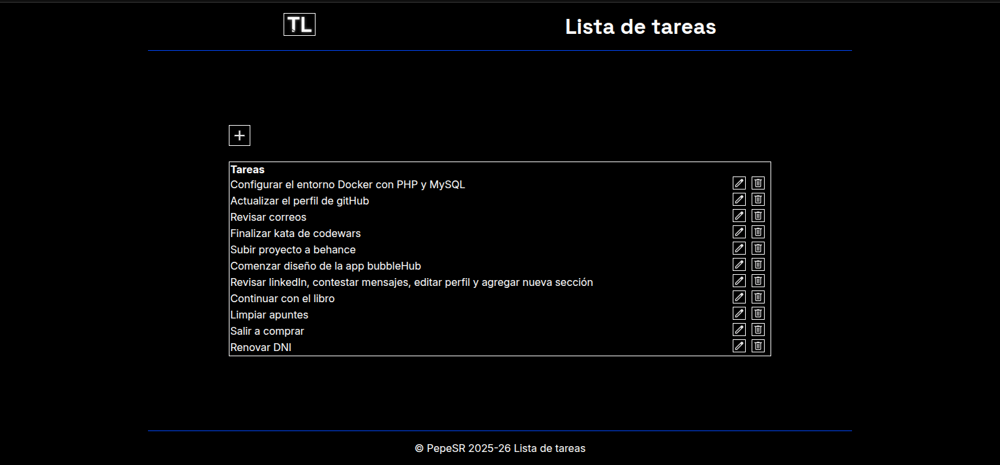

# TaskList
Aplicación básica para gestionar tareas.
Crea, edita o elimina las tareas almacenadas.

## 📸 Captura de pantalla

## 🛠️ Tecnologías utilizadas
* HTML5 / CSS3 / SQL / MySQL / php
* Framework: NO
* Docker: Si

## 📦 Instalación

- Descarga el repositorio: `gh repo clone pepesr-dev/taskList`
- Entra en la carpeta específica de la app: `cd taskList`
- Ejecutar la función: `docker compose up -d`
- Ver en el navegador: `localhost:8080`

## Contribuciones
Esta app no acepta contribuciones.